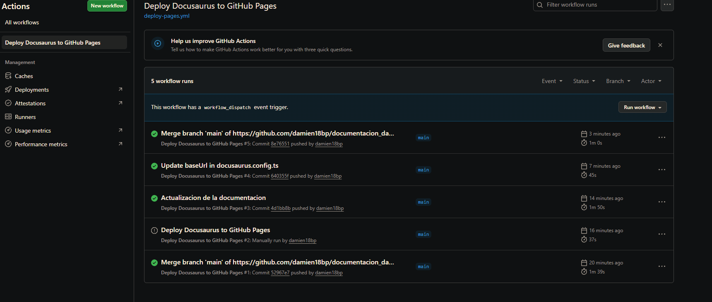
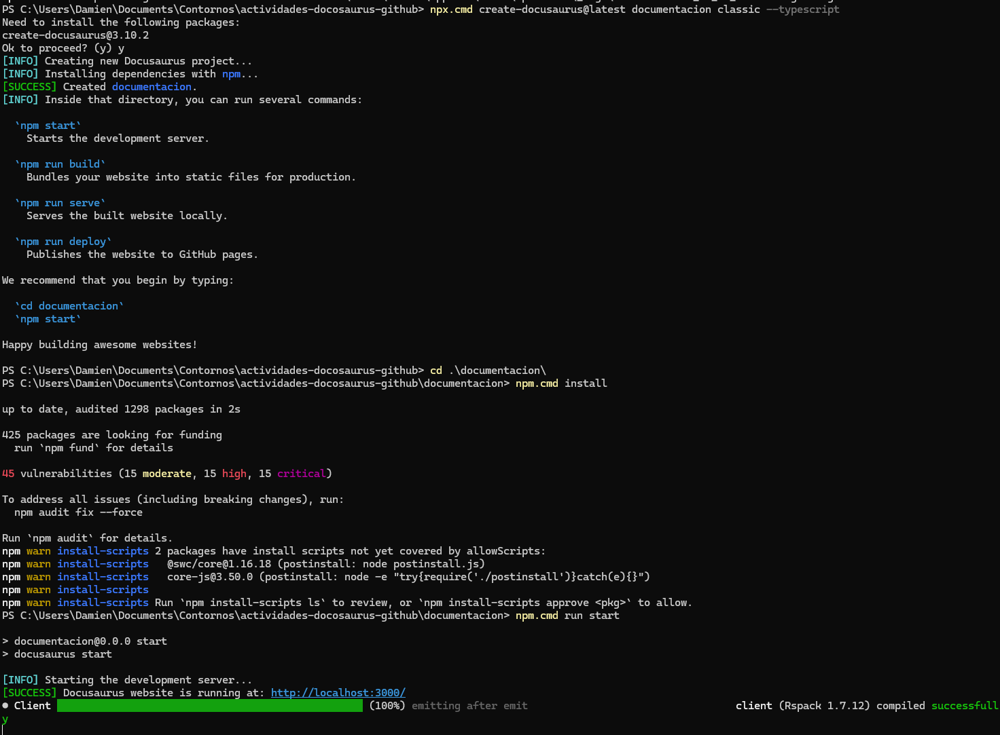
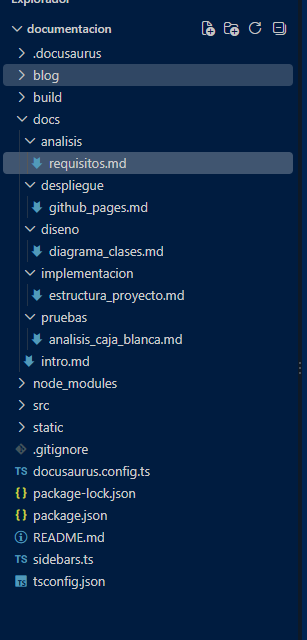
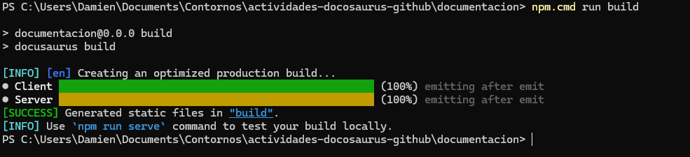
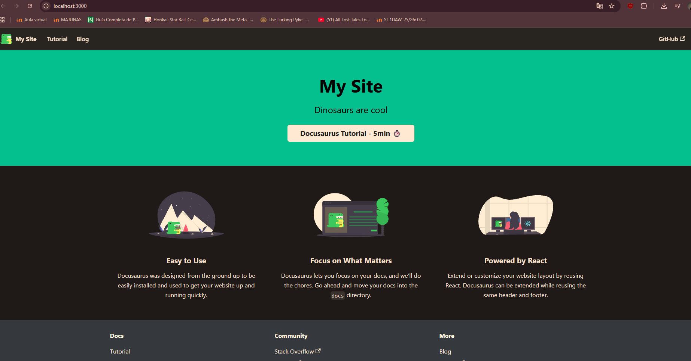
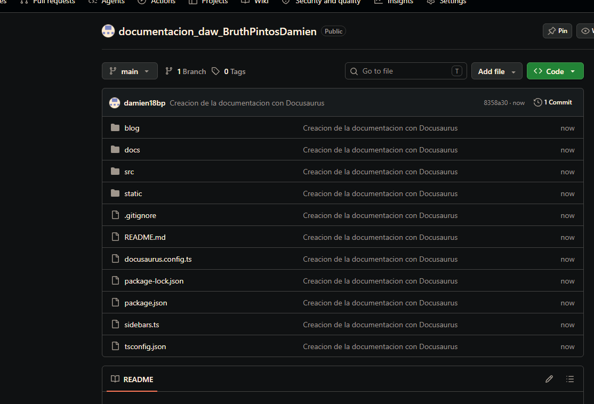
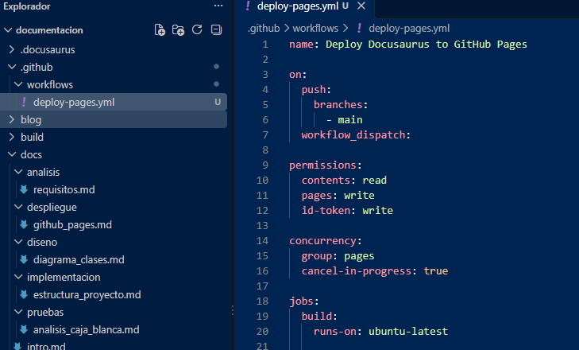
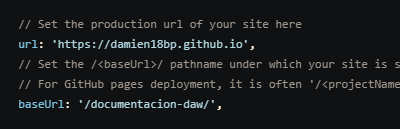
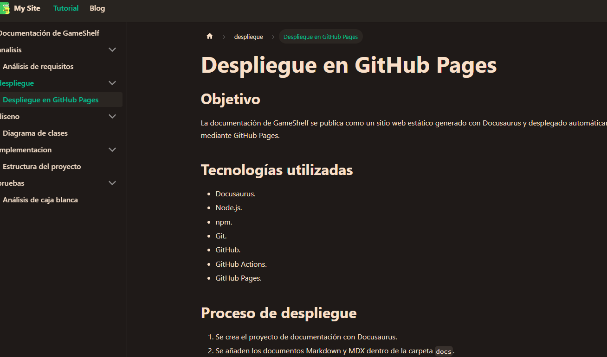

# Informe de la tarea 1.2

## Link al repositorio

https://github.com/damien18bp/documentacion_daw_BruthPintosDamien

## URL del sitio publicado en GitHub Pages

https://damien18bp.github.io/documentacion_daw_BruthPintosDamien/

## Workflows



## Estructura creada en Docusaurus

La estructura principal del proyecto es la siguiente:

```text
documentacion/
├── docs/
│   ├── intro.mdx
│   ├── analisis/
│   │   └── requisitos.md
│   ├── diseno/
│   │   └── diagrama_clases.md
│   ├── implementacion/
│   │   └── estructura_proyecto.md
│   ├── pruebas/
│   │   └── analisis_caja_blanca.md
│   └── despliegue/
│       └── github_pages.md
├── src/
├── static/
├── .github/
│   └── workflows/
│       └── deploy-pages.yml
├── docusaurus.config.ts
├── sidebars.ts
├── package.json
└── package-lock.json
```

La carpeta `docs/` contiene los documentos de la aplicación GameShelf. Los archivos se escriben en Markdown y Docusaurus los transforma en páginas web estáticas.

La carpeta `src/` contiene el código de la interfaz de la web de Docusaurus, mientras que `static/` almacena recursos estáticos, como imágenes, iconos o archivos que se publican sin transformación.

El archivo `docusaurus.config.ts` contiene la configuración general del sitio, incluyendo la URL y `baseUrl` necesarias para publicar correctamente en GitHub Pages.

El archivo `sidebars.ts` configura el menú lateral de la documentación. En este proyecto, la estructura de carpetas de `docs/` permite organizar los documentos por categorías: análisis, diseño, implementación, pruebas y despliegue.

La carpeta `.github/workflows/` contiene el workflow de GitHub Actions. El archivo `deploy-pages.yml` instala las dependencias, ejecuta el build de Docusaurus y publica la carpeta `build/` en GitHub Pages.


## Documento adicional

El documento adicional se trata de este informe y de la carpeta Imagenes donde viene recogido todos los pasos que hice.

- Instalacion de todo lo neceasrio para la realización del proyecto


- Creación de la estructura necesaria para la realiazación del ejercicio


-Actualizamos la web para que se visualice nuestros cambios


- Imagenes de como se muestra la pagina nada mas iniciada


- Pasamos la tarea realizada en el equipo a la propia pagina de GitHub


- Creamos el apartado para que se pueda visualziar como pages en Github


- Modificamos el url para que sea acorde al que queremos


- Pagina final
