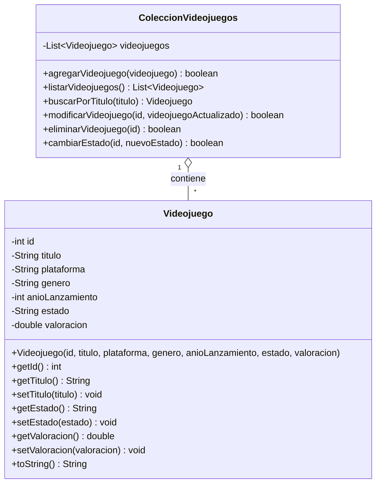

# Diagrama de clases

## Clases principales

El proyecto se organiza en dos clases principales:

- `Videojuego`: representa un juego individual de la colección.
- `ColeccionVideojuegos`: gestiona la lista de videojuegos y las operaciones disponibles.

## Diagrama UML simplificado

## Responsabilidades

### Clase `Videojuego`

La clase `Videojuego` representa la información de un único videojuego. Guarda sus atributos y permite consultar o modificar sus datos mediante métodos getters y setters.

### Clase `ColeccionVideojuegos`

La clase `ColeccionVideojuegos` almacena una lista de objetos `Videojuego`. También contiene la lógica para añadir, buscar, modificar, eliminar y listar los juegos de la colección.

## Relación entre clases

Una instancia de `ColeccionVideojuegos` puede contener cero, uno o varios objetos de tipo `Videojuego`.

Por ejemplo, una colección puede tener los juegos *The Binding of Isaac*, *Genshin Impact* y *Brawl Stars*, cada uno representado por un objeto diferente.